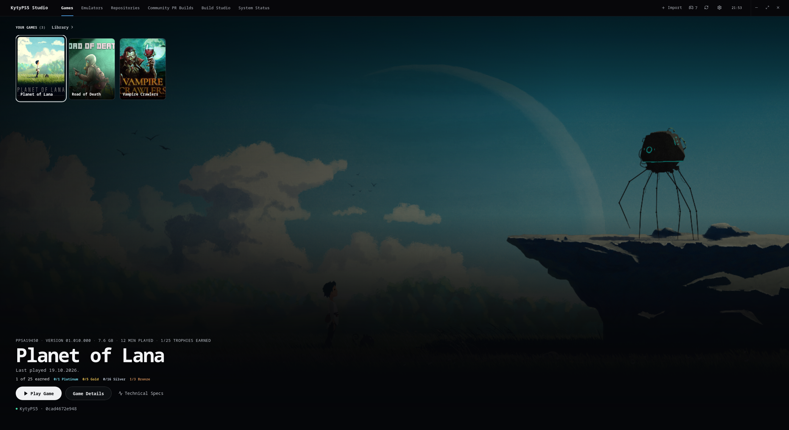
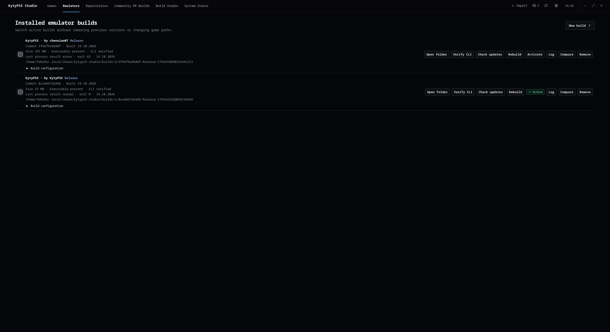
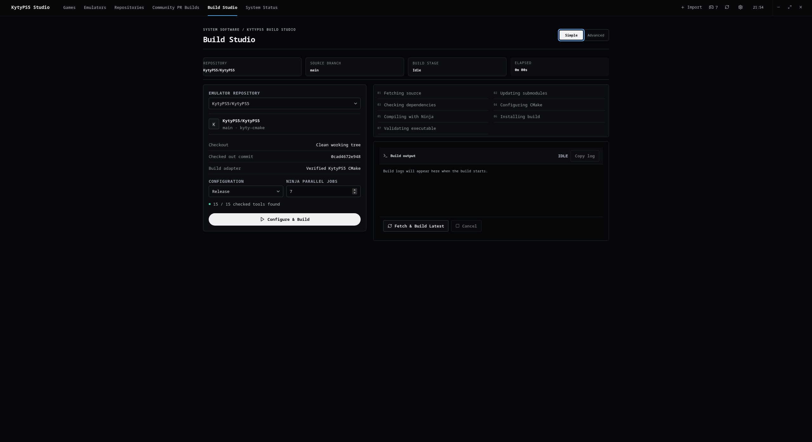

# KytyPS5 Studio

KytyPS5 Studio is a desktop app for Linux and Windows 10/11 x64 that manages KytyPS5 source checkouts, emulator builds, game folders, and launch logs in one place.

> **This project is not affiliated with or endorsed by the KytyPS5 developers.** The emulator source is maintained in the [official KytyPS5 repository](https://github.com/KytyPS5/KytyPS5). Studio can clone and build that source, as well as compatible forks. It does not include an emulator binary, games, or firmware.

## Screenshots

| Games | Emulator builds | Build Studio |
| --- | --- | --- |
|  |  |  |

The screenshots show the games home page, installed emulator builds, and the source build interface.

## What it does

- Organizes imported games without moving or copying the original files.
- Clones and manages the official KytyPS5 repository and compatible forks.
- Builds and keeps separate emulator versions, with controls to activate, compare, update, and remove them.
- Finds Community Pull Requests, reviews their changes, and can build compatible PR combinations while recording their exact commits.
- Matches games to the official KytyPS5 compatibility database by PPSA title ID and shows published test reports.
- Prioritizes compatibility reports for the current operating system and recommends a fork build only when a report can be matched to an exact verified source commit.
- Stores per-game launch options, session history, playtime, and emulator logs.
- Adds games to Steam and shares the current game through Discord Rich Presence when enabled.
- Shows host and Vulkan diagnostics to help troubleshoot build and launch problems.

See the [0.4.1 release notes](CHANGELOG.md) for this release's changes.

Successful compilation or CLI verification does **not** guarantee that a game will run. Compatibility depends on the emulator, game, drivers, and system configuration.

## Dedication and inspiration

KytyPS5 Studio is dedicated to everyone building tools that make experimental
PlayStation 5 projects easier to explore. Its interface and overall direction
were inspired in part by [AnyPS5 Studio](https://github.com/Ramzyayman/AnyPS5-Studio).
This is an independent project and is not affiliated with AnyPS5 Studio.

## Install a release

### Windows 10/11 x64

Download and run the Windows x64 NSIS `.exe` installer from the [GitHub Releases](https://github.com/Febsho/KytyPs5-Studio/releases) page. Follow the installer prompts. Windows application data and cache use LocalAppData, configuration uses Roaming AppData, and an optional GitHub token is stored in Windows Credential Manager.

### Linux

Download the Linux AppImage from the [GitHub Releases](https://github.com/Febsho/KytyPs5-Studio/releases) page, make it executable, and run it:

```sh
chmod +x "KytyPS5 Studio_0.4.1_amd64.AppImage"
./"KytyPS5 Studio_0.4.1_amd64.AppImage"
```

The AppImage filename may change between releases. Linux application data, cache, and configuration follow XDG user directories. An optional GitHub token is stored in Linux Secret Service.

KytyPS5 emulator builds on either platform require a working Vulkan driver. Building the emulator from Studio also requires the host development tools listed in the Build Studio dependency check.

## Build from source

### Linux

Install Node.js/npm, stable Rust, and the Tauri system dependencies for your distribution. Then run:

```sh
npm ci
npm run tauri dev
```

To create a native AppImage:

```sh
npm run tauri build -- --bundles appimage
```

The AppImage is written to:

```text
src-tauri/target/release/bundle/appimage/
```

For Arch Linux and CachyOS, the repository also includes a package recipe at [`packaging/arch/PKGBUILD`](packaging/arch/PKGBUILD).

### Windows 10/11 x64

Install Node.js/npm, stable Rust with the `x86_64-pc-windows-msvc` toolchain, Visual Studio 2022 Build Tools with the Desktop development with C++ workload and Windows 10/11 SDK, and the WebView2 runtime. Then run:

```powershell
npm ci
npm run tauri dev
```

To generate the Windows installer, install NSIS and run:

```powershell
npm run tauri build -- --bundles nsis
```

The NSIS installer is written to `src-tauri/target/release/bundle/nsis/`. Version tags (`v*`) also trigger GitHub Actions to build and attach the Windows installer and Linux release artifacts to a GitHub Release.

Git for Windows is required for repository and source management. Building the KytyPS5 emulator from Studio on Windows additionally requires Visual Studio 2022 C++ Build Tools, clang-cl (the Visual Studio C++ Clang tools workload), CMake 3.22.1 or newer, Ninja, glslangValidator, and Python 3. Studio checks these dependencies and reports missing tools before starting the build.

## Game files and privacy

Game files stay at their existing paths; Studio keeps their paths and metadata in its local library. Linux application data follows XDG (normally `~/.local/share/kytyps5-studio`); Windows uses LocalAppData for data/cache and Roaming AppData for configuration. GitHub access works anonymously within GitHub’s rate limits; optional tokens use Linux Secret Service or Windows Credential Manager.

Only add games and other content that you are authorized to use. This project does not provide games, firmware, decryption keys, or copyrighted content.

## AI assistance

AI tools were used to help develop and document this project. The project owner directs the work and is responsible for reviewing changes and releases. This statement does not imply that the KytyPS5 emulator itself was made with AI.

## License

KytyPS5 Studio is released under the [MIT License](LICENSE). The KytyPS5 emulator is a separate project with its own license and terms; see its [official repository](https://github.com/KytyPS5/KytyPS5).
